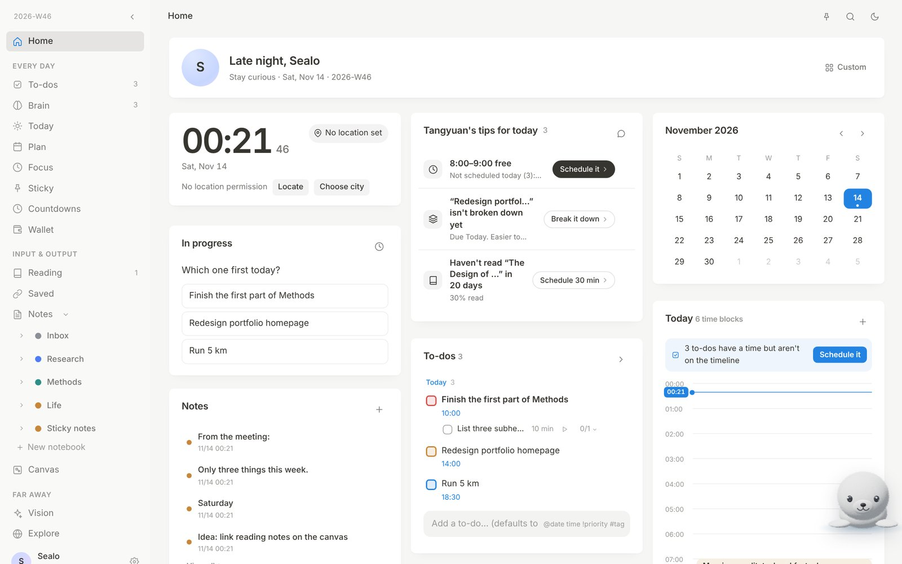
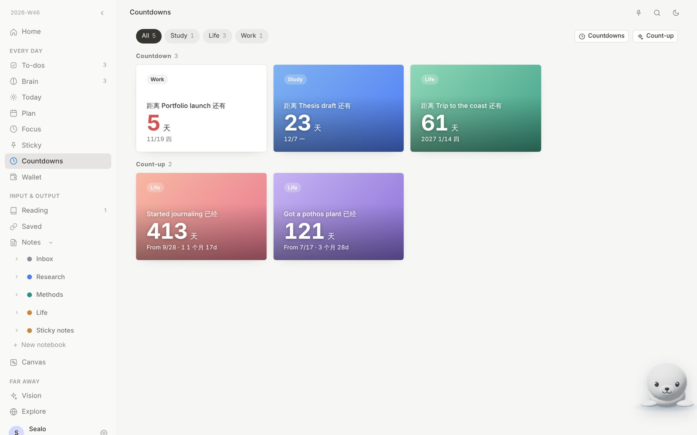
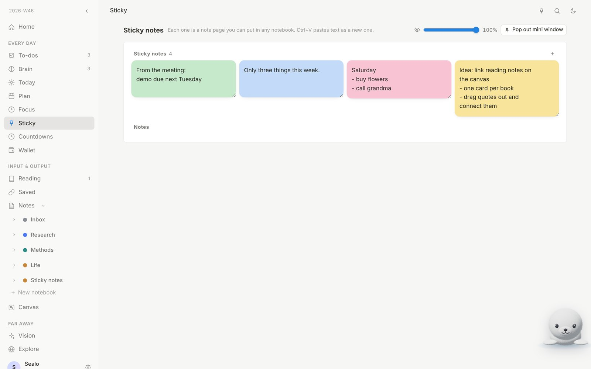
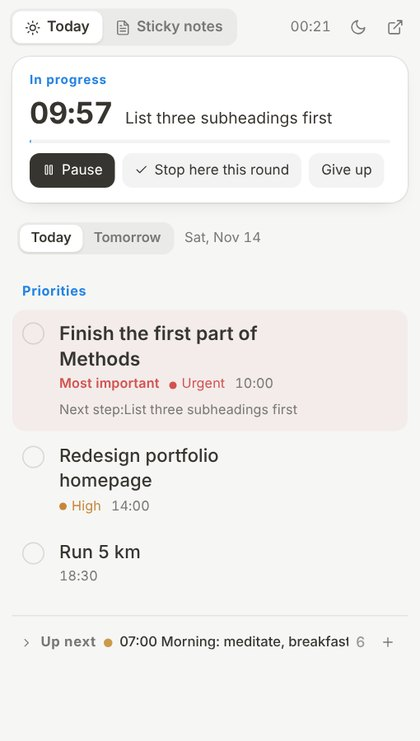

<div align="center">


# SealoNote

**Keep less in your head.**<br/>
To-dos, plans, notes, reading and long-term goals in one quiet place,<br/>
with a small seal named Tangyuan who turns what you type into a plan.

[**Website**](https://www.sealonote.com/home) · [**Open the app**](https://www.sealonote.com) · [**Download**](#download) · [Releases](../../releases)

English · [简体中文](README.zh-CN.md)

</div>

<br/>

<picture>
  <source media="(prefers-color-scheme: dark)" srcset="docs/screenshots/en/home-dark.jpg" />
  
</picture>

<br/>

## Why SealoNote

Most planning tools ask you to fill in forms. SealoNote lets you write the way you think. Type `write report @tomorrow 15:00-16:00`, or just tell Tangyuan what is on your mind. It becomes a time block, a to-do or a note, and nothing is saved until you have looked at it.

- **One place for the whole day.** To-dos, a timeline, focus sessions, notes and goals share the same data, so a task, its steps and the time you set aside for it stay in sync everywhere.
- **Picks up where you left off.** Each focus round ends with “where did you get to, what's next?”, and the next time you open that task, the answer is waiting for you.
- **Calm by design.** Paper-like layout, light and dark themes, no streaks, no badges, nothing that shouts.
- **Your data, your call.** Works offline and without an account. Sign in to sync across web, desktop and phone, with cloud history you can restore.

<br/>

## Download

|  | Installer | First launch |
|---|---|---|
| **Windows** | [SealoNote-win-x64.exe](../../releases/latest/download/SealoNote-win-x64.exe) | If you see “Windows protected your PC”, choose **More info → Run anyway** |
| **macOS** | [SealoNote-mac-universal.dmg](../../releases/latest/download/SealoNote-mac-universal.dmg) | Drag it into Applications. If macOS says the app is damaged, run `xattr -cr /Applications/Sealonote.app`, then right-click → Open |
| **Linux** | [SealoNote-linux-x86_64.AppImage](../../releases/latest/download/SealoNote-linux-x86_64.AppImage) | `chmod +x` it, then double-click |

Or just use it in the browser at **[sealonote.com](https://www.sealonote.com)**. The desktop app opens the same site with the same account, so web updates reach it with a refresh. Only window features (sticky notes, the separate Tangyuan window, the tray) need a new install.

<br/>

## What's inside

**Every day**

- **To-dos.** Four priority levels, dates and times, and steps you can tick off one by one. Anything past its time is flagged and can be postponed in one click.
- **Today.** A single timeline from morning to night. Time blocks are colour-coded, and checkpoints sit on the line to ask whether you got there.
- **Today's priorities.** One to three things that matter today, with the most important one at the top.
- **Focus.** A Time Timer–style Pomodoro. Starting the same task again continues the round instead of restarting it.
- **Sticky notes.** Each one is a real note page you can file in any notebook, or pin to your desktop.
- **Countdowns.** Count down to a deadline or up from a day that matters. Countdowns can have categories, gradient or photo backgrounds, and appear on the home page.
- **Wallet.** Assets, subscriptions (with reminders before they charge) and quick expense logging.

**Input & output**

- **Notes.** A block editor with notebooks, nested pages, backlinks, comments, version history and PDF attachments.
- **Canvas.** An infinite whiteboard with cards, sections, arrows and zoomable PDFs.
- **Reading & saved.** Books and papers with progress and reading speed, plus links saved in one paste.

**Far away**

- **Vision.** Affirmations, a vision board and long-term goals.
- **Explore.** Light up the places you've been and want to go on a globe you can spin.

<table>
<tr>
<td width="62%"></td>
<td width="38%"></td>
</tr>
</table>

<br/>

## Tangyuan, your little seal

The 3D seal in the corner is Tangyuan. Tell it something in plain words and it drafts to-dos, time blocks, notes or goals for you. You review the draft, edit anything inline, then save. Every save can be undone.

- *“Meeting tomorrow at 2pm, then file the notes in my Research notebook”* gives you a time block and a note.
- *“Fit what's overdue into the free time left today”* moves those to-dos to today and puts them on the timeline.
- *“Break my thesis draft into steps I can do this week”* creates one to-do per step, each with a time estimate.

Bring your own DeepSeek or Claude key (it stays in your browser), or turn AI off. With AI, plain sentences in any language work. Without AI, a short syntax does the job:

| You type | You get |
|---|---|
| `write report @tomorrow 15:00-16:00` | A 15:00–16:00 time block tomorrow, linked to the to-do |
| `run @today 20:30 !1` | A high-priority to-do today at 20:30 |
| `@tomorrow 9:00-10:30 group meeting` | A time block tomorrow morning |
| `submit paper @2026-11-20 #study` | A to-do on Nov 20, tagged *study* |

Without AI, everyday Chinese phrasing such as `明天下午3点到4点 写周报` is understood too.

<br/>

## Desktop app

<table>
<tr>
<td width="34%"></td>
<td>

- **Desktop sticky.** A small window that can stay on top, with adjustable opacity. **Today** shows your priorities, what's due and what's next, and a running focus round sits at the top. **Sticky notes** holds your notes.
- **Single sticky notes.** Drag a note out of the window and it becomes its own little window that remembers its place, size, pin and opacity, even after a restart. `Ctrl+N` makes a new one, and `Ctrl+V` turns the clipboard into one.
- **Tangyuan in its own window**, so the chat never covers your work.
- **Tray menu.** Open the sticky or Tangyuan, or launch only the sticky at login.
- No system title bar. The window buttons follow your theme.

</td>
</tr>
</table>

<br/>

## Pricing

**Free during the beta.** Sign-up needs an invite code.

| | Price | What you get |
|---|---|---|
| **Local** | Free | Every feature, no account. Data stays in this browser, and you can export it anytime |
| **Account** | Free | Sync across web, desktop and phone, cloud history, and 60 Tangyuan AI requests a month |
| **Bring your own key** | Free + your API costs | Unlimited AI with your own DeepSeek or Claude key, paid directly to them |

<br/>

## Your data

- Everything is saved on your device first, then synced to the cloud (Supabase) when you are signed in. Each account can only read and write its own data.
- Edits from several devices or windows merge instead of overwriting each other.
- The cloud keeps earlier versions you can restore from Settings. If a sync would suddenly remove a lot, it stops and asks first.
- AI keys never leave your browser and are not part of the synced data.

<br/>

## Self-hosting

The frontend is a static site with no build step (Preact + htm), and the backend is a few serverless functions.

1. Create a Supabase project and run [`supabase/schema.sql`](supabase/schema.sql), then [`supabase/history-and-guard.sql`](supabase/history-and-guard.sql) in the SQL editor.
2. Deploy this repository to a serverless host (no build command) with these environment variables:

   | Variable | Purpose |
   |---|---|
   | `SUPABASE_URL` / `SUPABASE_ANON_KEY` | Your Supabase project |
   | `SUPABASE_SERVICE_ROLE_KEY` | Server-side only |
   | `SESSION_SECRET` | Any long random string |
   | `DEEPSEEK_API_KEY` / `ANTHROPIC_API_KEY` | Optional, for Tangyuan |

3. The desktop app lives in [`desktop/`](desktop) and is a thin Electron shell. Bump the version in `desktop/package.json`, then run **Desktop app** in Actions to build and publish installers for all three platforms.

```bash
# Local preview
python3 -m http.server 8000      # then open http://localhost:8000
cd desktop && npm install && SEALONOTE_URL=http://localhost:8000 npm start
```

<br/>

<div align="center">
<sub>Made with care by Riley · Tangyuan is Riley and Juniper's little seal · <a href="https://www.sealonote.com/home">sealonote.com</a></sub>
</div>
