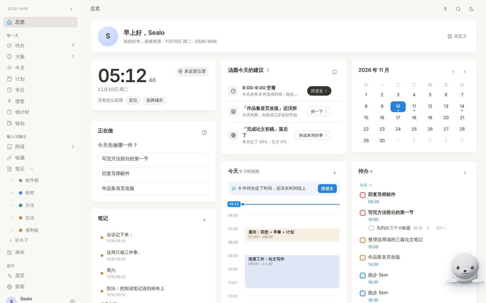
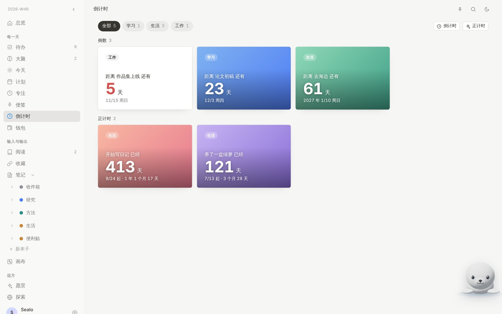
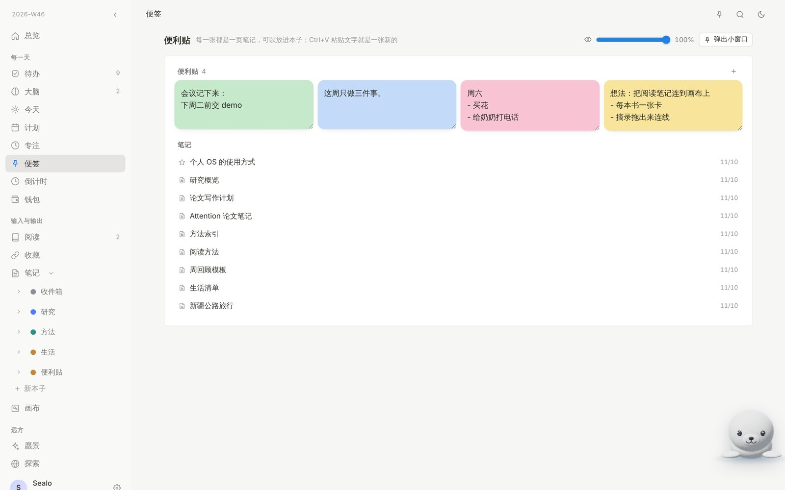
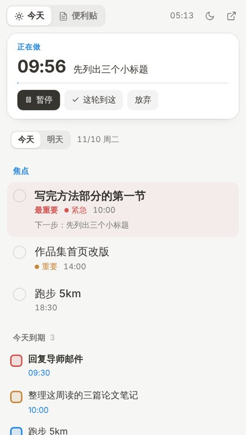

<div align="center">


# SealoNote 海豹笔记

**少放一点在脑子里。**<br/>
待办、计划、笔记、阅读、愿景，放在同一个安静的地方；<br/>
有一只叫汤圆的小海豹，帮你把随手打的话变成安排。

[**官网**](https://www.sealonote.com/home) · [**打开网页版**](https://www.sealonote.com) · [**下载**](#下载) · [更新记录](../../releases)

[English](README.md) · 简体中文

</div>

<br/>

<picture>
  <source media="(prefers-color-scheme: dark)" srcset="docs/screenshots/home-dark.jpg" />
  
</picture>

<br/>

## 为什么是它

大多数计划工具要你填表。SealoNote 让你按自己想的方式写：打一句「明天下午3点到4点 写周报」，或者把脑子里的事跟汤圆说一句，它就变成时间块、待办或笔记。你看过觉得行，才存。

- **一天的事都在一起**：待办、时间线、专注、笔记、目标用的是同一份数据。一件事、它的步骤、给它留的时间，在哪儿改都同步。
- **接着上次**：每轮专注结束问一句「做到哪了、下一步是什么」，下次打开这件事，答案就在那里等你。
- **安静的设计**：纸张感的排版，浅色深色两套主题，没有连续打卡、没有徽章，没有东西对你大喊。
- **数据你说了算**：不登录也能用，离线也能用。登录后网页、桌面、手机之间同步，云端留着历史版本可以恢复。

<br/>

## 下载

|  | 安装包 | 第一次打开 |
|---|---|---|
| **Windows** | [SealoNote-win-x64.exe](../../releases/latest/download/SealoNote-win-x64.exe) | 提示「Windows 已保护你的电脑」时，点「更多信息 → 仍要运行」 |
| **macOS** | [SealoNote-mac-universal.dmg](../../releases/latest/download/SealoNote-mac-universal.dmg) | 拖进「应用程序」；提示「已损坏」时在终端运行 `xattr -cr /Applications/Sealonote.app`，再右键 → 打开 |
| **Linux** | [SealoNote-linux-x86_64.AppImage](../../releases/latest/download/SealoNote-linux-x86_64.AppImage) | `chmod +x` 之后双击 |

也可以直接在浏览器里用：**[sealonote.com](https://www.sealonote.com)**。桌面版打开的就是这个网站，同一个账号、同一份数据。网页上更新了，桌面版刷新一下就用上；只有窗口本身的功能（便签、独立的汤圆窗口、托盘）需要装新版本。

<br/>

## 都有什么

**每一天**

- **待办**：四级优先级、日期时间、可以一步步勾掉的子步骤；到点没做会标出来，一键推迟。
- **今天**：一条从早到晚的时间线。时间块按类型着色，「检查点」是线上的一个点，到点问你做到了没有。
- **今日焦点**：每天最重要的一到三件事，第一件就是「最重要的一件」。
- **专注**：照 Time Timer 做的番茄钟。同一件事再点开始会接着计时，不会重开。
- **便签**：每一张便利贴都是一页真正的笔记，可以放进任何本子，也可以单独贴到桌面上。
- **倒计时**：倒数到 deadline，或者正着数某个重要的日子过了多久。可以分类，换渐变或照片背景，也能放在总览上。
- **钱包**：资产、订阅（扣费前提醒）、一句话记账。

**输入与输出**

- **笔记**：块编辑器，按本子整理，页面可以嵌套，有双向链接、评论、历史版本和 PDF 附件。
- **画布**：无限白板，卡片、分区、连线，PDF 可以缩放。
- **阅读 / 收藏**：书和论文的进度、读速；链接一贴就存。

**远方**

- **愿景**：肯定句、愿景板、长期目标。
- **探索**：在一颗可以转动的星球上点亮去过和想去的地方。

<table>
<tr>
<td width="62%"></td>
<td width="38%"></td>
</tr>
</table>

<br/>

## 汤圆

角落里那只 3D 小海豹就是汤圆。用平常的话跟它说一句，它会帮你起草待办、时间块、笔记或目标。你先看草稿，哪条不对直接改，确认了才保存；保存之后也能一键撤销。

- 「明天下午两点开组会，会后把纪要整理到研究本子」→ 一个时间块，加一页笔记
- 「把今天到期还没排的事排进剩下的空档」→ 原来那几件待办挪到今天、排进时间线
- 「把论文初稿拆成这周能做的几步」→ 每一步一件待办，附带时长

可以接自己的 DeepSeek 或 Claude 密钥（只存在你自己的浏览器里），也可以不用 AI。不用 AI 的时候，平常的写法也认得：

| 打字 | 变成 |
|---|---|
| `明天下午3点到4点 写周报` | 明天 15:00–16:00 的时间块 |
| `周五晚上8点半 跑步 !1` | 周五 20:30 的待办，重要 |
| `下周一 9:00-10:30 组会` | 下周一的时间块 |
| `11月20号 交报告 #学习` | 11 月 20 日的待办，带标签 |

<br/>

## 在 Claude 里用

SealoNote 也是一个远程 MCP 服务：Claude（网页、桌面、手机）可以在你让它做事的时候，直接查看和修改你的安排。

1. 在 Claude 里打开 **设置 → 连接器 → 添加自定义连接器**，地址填 `https://www.sealonote.com/mcp`。
2. 点 **连接**，没登录的话先登录 SealoNote，然后点 **允许**。
3. 直接说：「我今天有什么事？」「明天下午三点给银行打电话，留一个小时」。

Claude 能看到待办、时间线、焦点、倒计时、笔记和画布，能新建和修改待办、时间块、笔记、便利贴，还能在画布上加卡片、分区和箭头，不能删除任何东西。随时可以在 **设置 → 连接 Claude** 里一键取消所有授权。

<br/>

## 桌面版

<table>
<tr>
<td width="34%"></td>
<td>

- **桌面便签**：一个可以置顶、能调透明度的小窗口。「今天」页有焦点、今天到期的待办和接下来的安排，正在专注的那一轮显示在最上面；「便利贴」页放你的便利贴。
- **单张便利贴**：把一张便利贴拖到窗口外面，它就变成一个独立的小窗口，记得自己的位置、大小、置顶和透明度，重启后也会回到原位。`Ctrl+N` 新建一张，`Ctrl+V` 把剪贴板贴成一张。
- **汤圆单独一个窗口**，对话不会盖住你正在做的事。
- **托盘**：开关便签和汤圆窗口，可以设置开机只启动便签。
- 没有系统标题栏，窗口按钮跟着主题走。

</td>
</tr>
</table>

<br/>

## 价格

**内测期间全部免费**，注册需要邀请码。

| | 价格 | 内容 |
|---|---|---|
| **本地** | 免费 | 全部功能，不用登录；数据只在这台设备的浏览器里，随时可以导出 |
| **账号** | 免费 | 网页、桌面、手机之间同步，云端历史版本，汤圆 AI 每月 60 次 |
| **自带密钥** | 免费 + 你自己的 API 费用 | 填自己的 DeepSeek 或 Claude key，AI 不限次数，费用直接付给它们 |

<br/>

## 你的数据

- 所有改动先存在你的设备上，登录后再同步到云端（Supabase）。每个账号只能读写自己的那一份。
- 几台设备、几个窗口同时改，会合并起来，不会互相覆盖。
- 云端会留着之前的版本，在设置里可以恢复；如果一次同步里数据突然少了很多，会先停下来问你。
- AI 密钥只存在你的浏览器里，不进同步数据。

<br/>

## 自己部署

前端是不需要构建的静态页面（Preact + htm），后端是几个无服务器函数。

1. 在 Supabase 新建项目，在 SQL Editor 里依次运行 [`supabase/schema.sql`](supabase/schema.sql) 和 [`supabase/history-and-guard.sql`](supabase/history-and-guard.sql)。
2. 把这个仓库部署到一个无服务器托管平台（不需要构建命令），填好环境变量：

   | 变量 | 说明 |
   |---|---|
   | `SUPABASE_URL` / `SUPABASE_ANON_KEY` | Supabase 项目地址和 anon key |
   | `SUPABASE_SERVICE_ROLE_KEY` | 只在服务端用 |
   | `SESSION_SECRET` | 一串足够长的随机字符 |
   | `DEEPSEEK_API_KEY` / `ANTHROPIC_API_KEY` | 可选，汤圆用的 AI |

3. 桌面版在 [`desktop/`](desktop) 目录里，是一个很薄的 Electron 外壳。改 `desktop/package.json` 里的版本号后，在 Actions 里运行 **Desktop app**，就会打出三个系统的安装包并发布到 Releases。

```bash
# 本地预览
python3 -m http.server 8000      # 打开 http://localhost:8000
cd desktop && npm install && SEALONOTE_URL=http://localhost:8000 npm start
```

<br/>

<div align="center">
<sub>Made with care by Riley · 汤圆是 Riley 和 Juniper 的小海豹 · <a href="https://www.sealonote.com/home">sealonote.com</a></sub>
</div>
